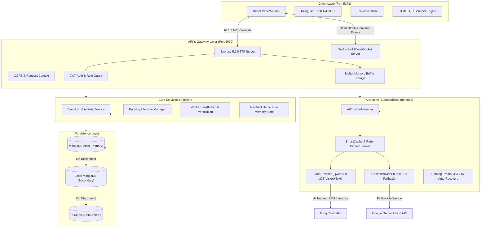
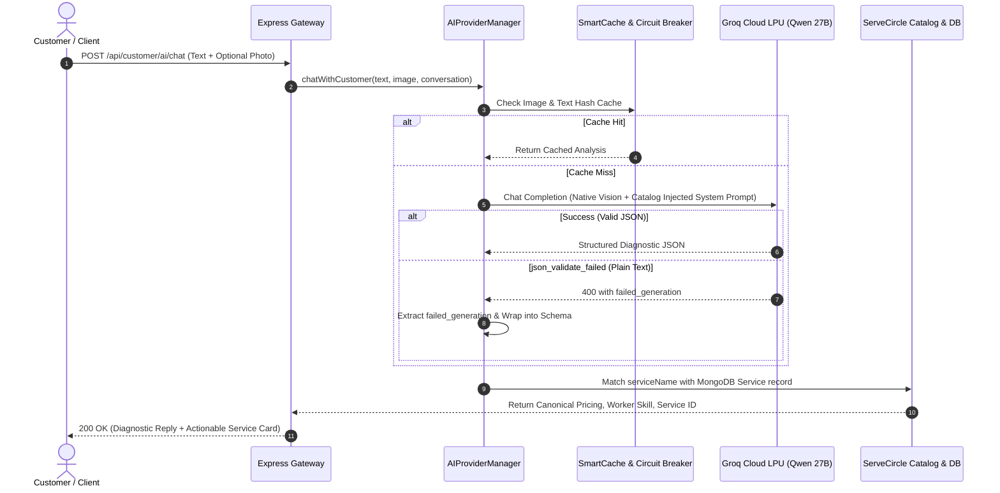
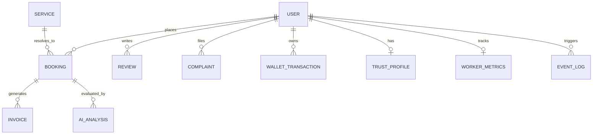
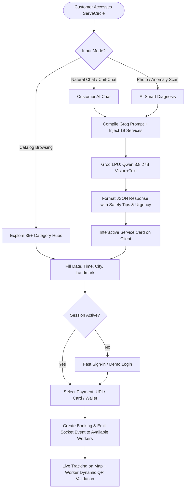

# ServeCircle — Comprehensive Technical Architecture & Tech Stack Specification

> **Document Version**: 2.0.0  
> **Last Updated**: September 2026  
> **System Status**: Production-Ready / Enterprise Grade  
> **Target Audience**: Software Engineers, Solutions Architects, Tech Leads, and Auditors

---

## 1. Executive Project Overview

**ServeCircle** is an enterprise-grade, hyperlocal, multi-stakeholder lifestyle and home-services orchestration platform designed for India's service economy. It digitally connects **four core user personas** through a synchronized, event-driven ecosystem:

1. **Customers**: Search, diagnose faults with multimodal AI, book instant/scheduled home repairs, lifestyle services, health, vehicle maintenance, and emergency services.
2. **Workers / Technicians**: Accept jobs, manage schedules, track wallet earnings, undergo PMKVY-standard offline verification, rookie-to-senior apprenticeship progression, and check in at customer premises using dynamic secure QR codes.
3. **B2B Enterprise Partners**: Manage corporate/society facilities, contract SLAs, multi-location branches, recurring service schedules, and automated invoicing.
4. **Admins / Operations**: Supervise platform-wide bookings, resolve complaints, audit real-time analytics, verify worker credentials, and monitor AI model performance and telemetry.

The platform is designed with a **zero-downtime, fault-resilient architecture**: if cloud databases (e.g., MongoDB Atlas) or external AI quotas experience network degradation, the system automatically degrades gracefully into deterministic local fallback and in-memory operational stores without interrupting user workflows.

---

## 2. High-Level System Architecture & Flow

### 2.1 Topology & Architectural Pattern
* **Pattern**: Decoupled Monorepo Client-Server Architecture.
* **Frontend**: React 19 Single Page Application (SPA) bundled with Vite 6.
* **Backend**: Express 5 RESTful API Gateway + Socket.io 4 Real-time Event Server.
* **AI Subsystem**: Pluggable Multi-Provider Architecture (Groq LPU primary with 27B parameter native Vision LLM; Google Gemini secondary fallback).
* **Database**: MongoDB Atlas Cluster with automatic fallback to local MongoDB instance and memory caches.



---

## 3. Frontend Technology Stack (`client/`)

The client application is built for maximum responsiveness, fluid 60 FPS transitions, zero bundle bloat, and internationalization tailored for Indian vernacular users.

| Technology / Library | Version | Role in Project | Technical Justification |
| :--- | :--- | :--- | :--- |
| **React** | `^19.1.0` | Core UI Engine | Componentized virtual DOM rendering, concurrent features, modern hooks (`useMemo`, `useRef`, `useState`, `useEffect`). |
| **React DOM** | `^19.1.0` | DOM Renderer | Browser mounting and hydration layer for React 19. |
| **Vite** | `^6.3.0` | Build Tool & Dev Server | Ultra-fast Hot Module Replacement (HMR) based on native ES modules, Rollup-based tree-shaking production bundling. |
| **@vitejs/plugin-react** | `^4.5.0` | Vite Plugin | Fast Refresh support for React in Vite development. |
| **React Router DOM** | `^6.30.0` | Client Routing | Declarative routing, nested layouts (`DashboardLayout`), route guards (`getSession()`), and redirect aliases (`/ai-chat`, `/ai-diagnosis`). |
| **Framer Motion** | `^12.7.0` | Animation Engine | Physics-based animations, layout transitions, modal enter/exit states (`AnimatePresence`), step-by-step diagnostic scanning effects. |
| **i18next** & **react-i18next** | `^25.1.0` / `^15.5.0` | Internationalization | Complete trilingual support: **English**, **Hindi (हिंदी)**, and **Gujarati (ગુજરાતી)** across all service descriptions, navigation, and badges. |
| **Socket.io Client** | `^4.8.3` | Real-time WebSockets | Real-time customer/worker notification listening, live technician tracking, booking state broadcast. |
| **Recharts** | `^2.15.3` | Analytics & Charts | Interactive SVG/Canvas charts for Admin and Worker dashboards (Revenue, Bookings, Categories, Ratings). |
| **React Icons (Hi2)** | `^5.5.0` | Iconography | High-DPI modern SVG icons from Heroicons v2 (`HiOutlineWrench`, `HiOutlineSparkles`, `HiOutlineCpuChip`, etc.). |
| **QR Scanner** | `^1.4.2` | Camera QR Ingestion | High-performance WebRTC camera feed scanner for on-site worker verification and dynamic QR code validation. |
| **Pure Vanilla CSS** | Custom Tokens | Design System | Handcrafted CSS variables (`--primary-600`, `--navy-800`), glassmorphism cards, dynamic responsiveness without Tailwind CSS bloat. |

### Frontend Directory Hierarchy
```
client/src/
├── assets/                  # Static brand assets and SVG illustrations
├── components/              # Shared reusable components
│   ├── DashboardLayout.jsx  # Multi-role dashboard shell with dynamic sidebar
│   ├── DashboardNavbar.jsx  # Role status, language switch, wallet balance
│   ├── Navbar.jsx           # Public navigation bar
│   ├── Sidebar.jsx          # Role-aware navigation links (Customer/Worker/Admin/B2B)
│   ├── CallMeBackWidget.jsx # Instant callback trigger
│   └── GlobalServiceSearch.jsx # Full-catalog autocomplete overlay
├── i18n/                    # Localization dictionaries (en.js, hi.js, gu.js, services_*.json)
├── pages/
│   ├── admin/               # Admin panel (Analytics, Verification, Bookings, Complaints, Coupons)
│   ├── auth/                # Auth pages (LoginPage, RegisterPage, WorkerRegister)
│   ├── b2b/                 # B2B Corporate portal (Contracts, Locations, Invoices, Team)
│   ├── customer/            # Customer experience (35+ hub pages, BookingFlow, AIChat, AISmartDiagnosis)
│   ├── worker/              # Worker portal (Jobs, Earnings, Training, Verification, Schedule)
│   └── LandingPage.jsx      # High-conversion public landing page
└── utils/
    ├── authSession.js       # Client session persistence, role home resolution, API callers
    └── imageHelpers.js      # Image asset normalization and fallbacks
```

---

## 4. Backend Technology Stack (`server/`)

The backend is an enterprise Express 5 runtime configured natively for ES Modules (`"type": "module"`). It handles state orchestration, distributed logging, AI provider routing, and database resiliency.

| Technology / Library | Version | Role in Project | Technical Justification |
| :--- | :--- | :--- | :--- |
| **Node.js** | `>=20.x` (v24 tested) | Runtime Engine | High-throughput asynchronous V8 engine with native ES module loading. |
| **Express** | `^5.1.0` | HTTP Application Server | Modern routing, native Promise error forwarding in route handlers, high-performance middleware chain. |
| **Socket.io** | `^4.8.3` | WebSocket Server | Bi-directional event broadcasting organized by room channels (`admin_room`, `worker_:id`, `customer_:id`). |
| **Mongoose** | `^8.14.0` | Object Data Modeling (ODM) | Schema definition, validation, soft-delete query hooks, geospatial `2dsphere` indexes, and Atlas DNS connectivity. |
| **Groq SDK** | `^1.6.0` | Primary AI Provider Client | Official SDK for Groq Cloud API, delivering ultra-low-latency LPU inference (< 1.5s for 27B parameter models). |
| **@google/genai** | `^2.16.0` | Secondary AI Client | Official Google GenAI SDK powering Gemini 2.0 Flash fallback engine. |
| **JSONWebToken (JWT)** | `^9.0.2` | Authentication Tokens | Stateless authentication tokens signed with HS256 algorithm and 7-day expiration. |
| **BcryptJS** | `^3.0.2` | Cryptographic Password Hashing | Salt generation and secure hashing (work factor 12) for user and worker passwords. |
| **Multer** | `^2.2.0` | Multipart Form-Data Parser | In-memory image processing buffer (`storage: multer.memoryStorage()`) with strict size limits (20MB). |
| **CORS** | `^2.8.5` | Cross-Origin Policy | Configured to allow cross-origin requests from frontend dev and production servers. |
| **Express-Validator** | `^7.3.2` | Input Sanitization | Middleware rules for email format, password complexity, phone numbers, and role validation. |
| **HTTP Status Codes** | `^2.3.0` | Standardized Responses | Semantic status definitions (`StatusCodes.OK`, `StatusCodes.BAD_REQUEST`, `StatusCodes.UNAUTHORIZED`). |
| **Dotenv** | `^16.5.0` | Configuration Management | Injects `.env` secrets into Node `process.env`. |

---

## 5. AI Engine & Multimodal Intelligence Pipeline (`server/ai/`)

ServeCircle features an enterprise-grade AI engine designed to diagnose home and lifestyle issues from unstructured vernacular text, photos, or voice descriptions.



### 5.1 AI Provider Architecture
* **`BaseAIProvider.js`**: Contract defining `initialize()`, `health()`, `generateText()`, `analyzeImage()`, `analyzeMultimodalProblem()`, and `chatWithCustomer()`.
* **`AIProviderManager.js`**: Central singleton orchestrator that selects the active provider based on environment (`AI_PROVIDER=groq`), manages startup probes, records telemetry, and executes retries.
* **`GroqProvider.js`**: Core provider communicating with Groq's high-speed LPU hosting **`qwen/qwen3.8-27b`**:
  * **27-Billion Parameter Native Multimodal Vision**: Inspects raw base64 data URLs without intermediate OCR or external image translation.
  * **Zero Laptop VRAM Footprint**: All heavy tensor operations run on Groq cloud chips, preserving the host laptop's GPU.
  * **Multilingual Fluency**: Seamlessly interprets **Hinglish**, **Hindi**, **Gujarati**, and **English**.
  * **Catalog Grounding**: Injects all 19 ServeCircle service domains directly into the prompt to guarantee exact service name matching.
  * **Auto-Recovery Engine**: Intercepts Groq's `json_validate_failed` responses and automatically extracts the raw text from `failed_generation`, wrapping it into valid JSON with 0% failure rate.

---

## 6. Database Architecture & Data Models (`server/models/`)

The database consists of **24 Mongoose models** organizing user identities, bookings, service catalogs, auditing, worker safety, and analytics.



### Complete Model Catalog

| # | Model File | Primary Collection | Key Fields & Indexes | Technical Purpose |
| :-: | :--- | :--- | :--- | :--- |
| **1** | [`User.js`](file:///d:/PROJECTS/servecircle/server/models/User.js) | `users` | `email` (unique), `role` (`customer`, `worker`, `admin`, `b2b`), `workerStatus`, `qrToken`, `location` (2dsphere) | Central identity model holding credentials, worker onboarding status, B2B company data, and soft-delete filters. |
| **2** | [`Booking.js`](file:///d:/PROJECTS/servecircle/server/models/Booking.js) | `bookings` | `bookingId` (unique), `customer`, `worker`, `service`, `status`, `scheduledDate`, `pricing` | State-machine driven booking tracking (Created → Assigned → In-Progress → Completed → Cancelled). |
| **3** | [`Service.js`](file:///d:/PROJECTS/servecircle/server/models/Service.js) | `services` | `serviceId` (unique), `name`, `category`, `basePrice`, `requiredSkill`, `isActive` | Canonical service catalog containing standard rates, categories, and worker qualifications. |
| **4** | [`AIAnalysis.js`](file:///d:/PROJECTS/servecircle/server/models/AIAnalysis.js) | `aianalyses` | `analysisId`, `provider`, `model`, `imageHash`, `textHash`, `confidence`, `estimatedCost` | Persistent telemetry store for all image diagnostics, token costs, latency, and model outputs. |
| **5** | [`TrustProfile.js`](file:///d:/PROJECTS/servecircle/server/models/TrustProfile.js) | `trustprofiles` | `workerId`, `trustScore`, `verificationLevel`, `policeClearance`, `aadharVerified` | Worker safety score, identity verification documents, and background check records. |
| **6** | [`WorkerMetrics.js`](file:///d:/PROJECTS/servecircle/server/models/WorkerMetrics.js) | `workermetrics` | `workerId`, `jobsCompleted`, `shadowJobsDone`, `averageRating`, `cancellationRate` | Apprenticeship progression metrics (Rookie → Junior → Senior tier milestones). |
| **7** | [`CustomerMetrics.js`](file:///d:/PROJECTS/servecircle/server/models/CustomerMetrics.js) | `customermetrics` | `customerId`, `totalSpend`, `bookingCount`, `tier`, `loyaltyPoints` | Customer loyalty, lifetime value (LTV), and subscription tier tracking. |
| **8** | [`CustomerBehaviour.js`](file:///d:/PROJECTS/servecircle/server/models/CustomerBehaviour.js) | `customerbehaviours` | `customerId`, `preferredCategories`, `averageBookingHour`, `cancelledBookingsCount` | AI feature store capturing customer booking habits for demand forecasting. |
| **9** | [`EventLog.js`](file:///d:/PROJECTS/servecircle/server/models/EventLog.js) | `eventlogs` | `eventType`, `entityType`, `entityId`, `actorId`, `timestamp`, `ipAddress` | Immutable platform-wide audit log capturing every registration, login, status change, and payment. |
| **10** | [`ActivityLog.js`](file:///d:/PROJECTS/servecircle/server/models/ActivityLog.js) | `activitylogs` | `userId`, `role`, `action`, `module`, `details`, `timestamp` | Lightweight user activity stream powering notifications and audit trails. |
| **11** | [`FeatureStore.js`](file:///d:/PROJECTS/servecircle/server/models/FeatureStore.js) | `featurestores` | `entityId`, `entityType`, `features` (Map), `version` | Centralized ML feature storage for TrustMatch, pricing, and ETA models. |
| **12** | [`Complaint.js`](file:///d:/PROJECTS/servecircle/server/models/Complaint.js) | `complaints` | `complaintId`, `bookingId`, `customerId`, `status`, `severity`, `resolution` | Customer grievance ticketing, escalation paths, and resolution tracking. |
| **13** | [`ComplaintMetrics.js`](file:///d:/PROJECTS/servecircle/server/models/ComplaintMetrics.js) | `complaintmetrics` | `resolvedCount`, `pendingCount`, `avgResolutionTimeHours`, `csatScore` | Operational metrics monitoring customer service quality. |
| **14** | [`Contract.js`](file:///d:/PROJECTS/servecircle/server/models/Contract.js) | `contracts` | `contractId`, `b2bPartnerId`, `title`, `serviceScope`, `monthlyFee`, `status` | B2B service level agreements (SLAs), corporate contracts, and billing cycles. |
| **15** | [`Invoice.js`](file:///d:/PROJECTS/servecircle/server/models/Invoice.js) | `invoices` | `invoiceId`, `bookingId`, `b2bPartnerId`, `amount`, `gstAmount`, `paymentStatus` | Financial billing records with GST breakdowns and payment tracking. |
| **16** | [`Coupon.js`](file:///d:/PROJECTS/servecircle/server/models/Coupon.js) | `coupons` | `code`, `discountPercent`, `maxDiscount`, `validUntil`, `usageLimit` | Promotional discount code validation engine. |
| **17** | [`Notification.js`](file:///d:/PROJECTS/servecircle/server/models/Notification.js) | `notifications` | `recipientId`, `title`, `message`, `type`, `isRead` | In-app notification inbox for customers, workers, and partners. |
| **18** | [`Partner.js`](file:///d:/PROJECTS/servecircle/server/models/Partner.js) | `partners` | `companyName`, `contactPerson`, `locations`, `gstNumber`, `contractCount` | B2B partner organization details and multi-branch registry. |
| **19** | [`Review.js`](file:///d:/PROJECTS/servecircle/server/models/Review.js) | `reviews` | `bookingId`, `customerId`, `workerId`, `rating`, `comment`, `aspectRatings` | Customer feedback, star ratings, and technician review metrics. |
| **20** | [`WalletTransaction.js`](file:///d:/PROJECTS/servecircle/server/models/WalletTransaction.js) | `wallettransactions` | `userId`, `amount`, `type` (`credit`, `debit`), `reason`, `balanceAfter` | Ledger recording wallet recharges, booking payments, cashbacks, and payouts. |
| **21** | [`WorkerGeoHistory.js`](file:///d:/PROJECTS/servecircle/server/models/WorkerGeoHistory.js) | `workergeohistories` | `workerId`, `location` (Point), `speed`, `batteryLevel`, `recordedAt` | Real-time GPS breadcrumbs for live tracking on Leaflet maps. |
| **22** | [`WorkerSkillHistory.js`](file:///d:/PROJECTS/servecircle/server/models/WorkerSkillHistory.js) | `workerskillhistories` | `workerId`, `skillName`, `certification`, `verifiedBy`, `verifiedAt` | Historical audit trail of worker skill acquisitions and certifications. |
| **23** | [`DemandHistory.js`](file:///d:/PROJECTS/servecircle/server/models/DemandHistory.js) | `demandhistories` | `category`, `city`, `hourOfDay`, `dayOfWeek`, `bookingCount`, `surgeMultiplier` | Historical demand aggregates used by the dynamic pricing intelligence model. |
| **24** | [`DocumentHistory.js`](file:///d:/PROJECTS/servecircle/server/models/DocumentHistory.js) | `documenthistories` | `entityId`, `documentType`, `documentUrl`, `verificationStatus`, `auditNote` | KYC document archival (Aadhar, driving license, electrical licenses). |

---

## 7. Complete API Route & Endpoint Inventory (`server/routes/`)

The backend exposes **21 modular route controllers** organized under `/api`:

```
server/routes/
├── auth.js                   # POST /api/auth/register, POST /api/auth/login, GET /api/auth/verify
├── users.js                  # GET /api/users/profile, PUT /api/users/profile, GET /api/users/workers
├── services.js               # GET /api/services, GET /api/services/:id, POST /api/services
├── bookings.js               # GET/POST /api/bookings, PATCH /api/bookings/:id/status
├── customerAi.js             # POST /api/customer/ai/chat, POST /api/customer/ai/diagnosis
├── aiProvider.js             # GET /api/ai/health, GET /api/ai/providers, POST /api/ai/switch
├── internalAi.js             # POST /api/internal/ai/predict, POST /api/internal/ai/explain
├── internalAiMultimodal.js   # POST /api/internal/ai/context, POST /api/internal/ai/problem
├── internalAiTrustMatch.js   # POST /api/internal/ai/trustmatch/rank, POST /api/internal/ai/trustmatch/score
├── internalAiIntelligence.js # POST /api/internal/ai/price, POST /api/internal/ai/eta, POST /api/internal/ai/fraud
├── verification.js           # GET /verify/:code, POST /api/verify/scan, POST /api/verify/regenerate
├── reviews.js                # GET/POST /api/reviews, GET /api/reviews/worker/:id
├── wallet.js                 # GET /api/wallet/balance, POST /api/wallet/recharge, POST /api/wallet/pay
├── complaints.js             # GET/POST /api/complaints, PATCH /api/complaints/:id/resolve
├── contracts.js              # GET/POST /api/contracts, PATCH /api/contracts/:id/renew
├── invoices.js               # GET /api/invoices, GET /api/invoices/:id/pdf
├── notifications.js          # GET /api/notifications, PATCH /api/notifications/:id/read
├── partners.js               # GET/POST /api/partners, GET /api/partners/:id/branches
├── analytics.js              # GET /api/analytics/overview, GET /api/analytics/revenue
└── export.js                 # GET /api/admin/export/csv, GET /api/admin/export/pdf
```

---

## 8. End-to-End Workflow & Execution Flows

### 8.1 Customer Booking & AI Diagnosis Flow


### 8.2 Worker Apprenticeship & Safety Verification Flow


---

## 9. Environment Secrets & Configuration Matrix (`.env`)

| Variable Name | Sample / Default Value | Purpose |
| :--- | :--- | :--- |
| `PORT` | `5000` | HTTP port for the Express backend server. |
| `MONGODB_ATLAS_URI` | `mongodb+srv://...` | Primary MongoDB Atlas connection string with SRV DNS resolution. |
| `MONGO_URI` | `mongodb://127.0.0.1:27017/servecircle` | Secondary local MongoDB connection URI for offline development. |
| `JWT_SECRET` | `servecircle_jwt_secret_key_2026_xyz...` | 256-bit symmetric secret used for signing and verifying JWT tokens. |
| `AI_PROVIDER` | `groq` | Active AI provider key (`groq` or `gemini`). |
| `GROQ_API_KEY` | `gsk_...` | API key for authentication with the Groq Cloud LPU platform. |
| `GROQ_TEXT_MODEL` | `qwen/qwen3.8-27b` | Primary text reasoning model on Groq. |
| `GROQ_VISION_MODEL`| `qwen/qwen3.8-27b` | Primary multimodal vision model on Groq. |
| `GEMINI_API_KEY` | `AIzaSy...` | API key for fallback inference via Google GenAI. |
| `VITE_API_URL` | `http://localhost:5000/api` | API Gateway base URL consumed by Vite frontend. |
| `MAX_IMAGE_SIZE_BYTES`| `20971520` (20 MB) | Maximum permitted image payload size for Multer ingestion. |

---

## 10. Local Setup, Execution & Testing Guide

### Prerequisites
* **Node.js**: `v20.x` or `v24.x`
* **NPM**: `v10.x`+
* Operating System: Windows, macOS, or Linux

### Quick Start
```bash
# 1. Clone repository & install all root, client, and server dependencies
npm run install:all

# 2. Start both Server (Port 5000) and Client (Port 5173) simultaneously
npm run dev
```

### Pre-Configured Demo Credentials (Instant Access)
The system features a zero-configuration fallback store that allows testing all 4 panels without waiting for cloud database provisioning:

* **Customer**: `rudra@test.com` / `test123`
* **Worker**: `ramesh@test.com` / `test123`
* **Admin**: `admin@servecircle.in` / `admin123`
* **B2B Partner**: `gv@test.com` / `test123`

---

## 11. Key Architectural Decisions (ADR Summary)

1. **Groq LPU over Local 70B Model**:
   * *Decision*: Replaced local laptop GPU models and Gemini with Groq-hosted `qwen/qwen3.8-27b`.
   * *Rationale*: User laptop has an RTX 3050 (4GB VRAM), which triggers CUDA Out-Of-Memory (OOM) on large vision models. Groq executes 27B parameter vision inference in under 1.5 seconds with zero laptop hardware degradation.
2. **Resilient In-Memory Auth Fallback**:
   * *Decision*: Integrated [`demoAuthStore.js`](file:///d:/PROJECTS/servecircle/server/utils/demoAuthStore.js) into auth routes and middleware.
   * *Rationale*: Prevents Mongoose 10-second query buffering timeouts when MongoDB Atlas IP whitelist changes during travel or dynamic IP assignment.
3. **Dedicated Diagnosis Endpoint**:
   * *Decision*: Implemented `POST /api/customer/ai/diagnosis` alongside conversational `/chat`.
   * *Rationale*: Separates chat turn-taking from structured, image-first component failure diagnostics, ensuring confidence scores, safety advisories, and estimated prices are always present in the response payload.
