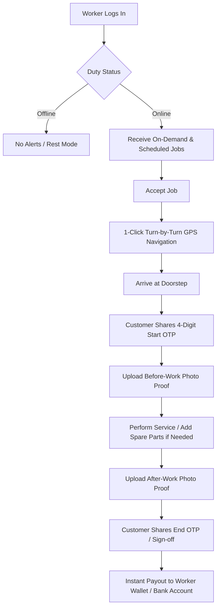
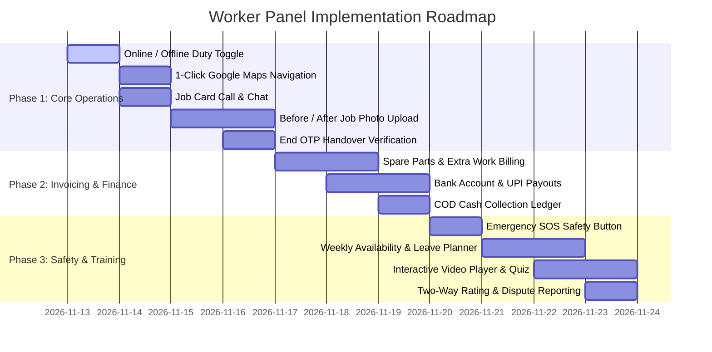

# ServeCircle — Worker Panel Analysis & Complete Roadmap 🛠️

> **Document Type:** Technical Audit, Feature Gap Analysis & Implementation Roadmap  
> **Platform:** ServeCircle (On-Demand Hyperlocal Home & Utility Services)  
> **Target Persona:** Service Professionals (Technicians, Plumbers, Electricians, Beauticians, Cleaners, Relocation Experts)  
> **Date:** November 2026  

---

## 1. Executive Summary & Current State Overview

ServeCircle currently possesses a functioning base for the **Worker Panel** (`/worker`), including role-based access, tier hierarchy (**Rookie / Junior Pro / Senior Pro**), an Amazon-style Start OTP verification system, live incoming call alerts, and digital ID card generation.

However, to evolve into a full-scale commercial platform matching industry benchmarks (such as **Urban Company Partner**, **TaskRabbit Tasker**, and **Uber Driver**), several essential operational, financial, safety, and workflow features remain either missing, static, or simulated.

---

## 2. Component-by-Component Audit

| File / Component | Current Implementation | Critical Gaps & Limitations |
| :--- | :--- | :--- |
| **`WorkerDashboard.jsx`** | Welcome greeting, Tier status card (Rookie shadow counter, Junior Pro, Senior Pro), Stats counter, Women Empowerment HUD, Growth Stepper. | ❌ No Online/Offline duty toggle. ❌ Stats are mostly computed locally without persistent analytics. ❌ Missing real-time daily earnings goal tracker. |
| **`WorkerJobs.jsx`** | Multi-tab queue (All, Pending, Accepted, En-Route, Arrived, Started, Completed, Cancelled). Doorstep Start OTP verification with real-time customer sync. | ❌ No turn-by-turn Google Maps link. ❌ No Before/After work photo upload. ❌ No extra spare parts billing feature. ❌ Missing End OTP verification. ❌ No direct worker-to-customer in-app call or chat buttons on job cards. |
| **`WorkerSchedule.jsx`** | 150-line list grouping bookings by date into cards. | ❌ No interactive weekly calendar grid. ❌ No working hours / availability slots selector (e.g. 9 AM - 7 PM). ❌ No "Apply Leave / Mark Day Off" feature. |
| **`WorkerEarnings.jsx`** | Gross vs Take-home calculation (20% fee), weekly gross, monthly table. | ❌ "Instant Withdrawal" button is a dummy `setTimeout` alert. ❌ No Bank Account (IFSC) or UPI ID (`worker@upi`) management. ❌ No Cash-on-Delivery (COD) cash deposit ledger. ❌ Missing incentive breakdown (Senior mentor bonus, surge bonus, tips). |
| **`WorkerTraining.jsx`** | Lists 4 PMKVY-certified modules with "Watch Now" toggle and 50-job Pro Badge progress bar. | ❌ "Watch Now" only toggles button state; no actual video player modal. ❌ No post-video quiz or skill assessment. ❌ "Download Certificate" button is non-functional (no PDF generation). |
| **`WorkerProfile.jsx`** | Bio details form, rating display, lifetime earnings snapshot, ID card viewer modal. | ❌ No document re-upload (Aadhar, Driving License, Police Verification). ❌ No preferred work radius / pincode zone selection. ❌ No customer reviews breakdown list. |
| **`WorkerCallWidget.jsx`** | Incoming paid consultation call alert card and voice console. | ✅ Working well, but needs direct integration into job queue cards. |

---

## 3. High-Priority Feature Requirements (Core Operations)

### 1. Online / Offline Duty Status Switch 🟢🔴
* **Problem:** Workers are treated as always active 24/7. They cannot pause incoming requests during personal time, lunch, or transit.
* **Solution:**
  * Prominent toggle in navbar & dashboard header: `🟢 Online (Receiving Jobs)` / `🔴 Offline (Off Duty)`.
  * Persisted in worker profile (`isOnline: boolean`).
  * Backend routing skips offline workers when auto-dispatching new bookings.

### 2. 1-Click Google Maps Turn-by-Turn GPS Navigation 🗺️
* **Problem:** Worker only sees text address (e.g., *"Satellite, Ahmedabad"*). They have to manually copy-paste into Google Maps.
* **Solution:**
  * Add **"Navigate on Google Maps"** CTA on active job cards (`status === 'en-route'`).
  * Direct intent URL: `https://www.google.com/maps/dir/?api=1&destination=${encodeURIComponent(job.address)}`.

### 3. Before & After Job Proof Photos 📸
* **Problem:** When customers claim improper work or accidental damage, there is no photographic evidence from either party.
* **Solution:**
  * **Before Work Photo:** Mandatory before entering Start OTP (e.g., condition of dirty AC, broken pipe, stained sofa).
  * **After Work Photo:** Mandatory before marking job complete.
  * Direct camera/gallery capture stored securely with timestamp watermarks.

### 4. Extra Spare Parts & Material Cost Billing 🧾
* **Problem:** Technicians frequently need extra materials (e.g., AC Capacitor ₹450, Copper Pipe ₹600, MCB Switch ₹300). Currently, job prices are strictly static.
* **Solution:**
  * **"Add Spare Parts / Materials"** modal in `/worker/jobs`.
  * Worker adds itemized list with prices.
  * System pushes real-time approval prompt to customer's tracking screen.
  * On customer approval, final invoice updates automatically.

### 5. Dual Verification: End OTP & Handover Protocol 🔐
* **Problem:** Currently, once work starts, the worker can click "Mark Complete" at any time without customer confirmation.
* **Solution:**
  * Amazon/Urban Company standard: When work finishes, customer's screen reveals a **4-digit End OTP**.
  * Worker must enter End OTP into their panel to release escrow payment.

### 6. Job-Card Calling & In-App Chat for Workers 📞💬
* **Problem:** Customer has Call/Chat on Live Tracking, but worker cannot initiate communication from `/worker/jobs`.
* **Solution:**
  * Add **"Call Customer"** and **"Chat with Customer"** buttons directly inside each active job card.
  * Connected to the same masked privacy relay and chat thread.

---

## 4. Medium-Priority Feature Requirements (Finance & Schedule)

### 7. Bank Account & UPI Payout System 🏦
* **Components Required:**
  1. **Bank Details Form:** Account Number, Confirm Account Number, IFSC Code, Account Holder Name, Bank Name.
  2. **UPI ID Support:** Support for VPA (e.g. `9876543210@paytm`, `worker@okhdfcbank`).
  3. **Real Withdrawal Ledger:** Status badges (`Pending`, `Processing`, `Credited`), UTR Reference Number, Date & Time.
  4. **COD Cash Deposit Ledger:** Tracks cash collected directly from customers vs. platform commission due.

### 8. Incentive & Bonus Breakdown 🎁
* Clear cards detailing:
  * **Rookie Shadow Bonus:** ₹50 extra per trainee shadow job for Senior Pros.
  * **Surge / Peak Hour Bonus:** ₹100 extra during festival / weekend rushes.
  * **5-Star Rating Performance Bonus:** Monthly bonus for ratings above 4.8.

### 9. Interactive Weekly Availability & Leave Management 📅
* **Components Required:**
  1. **Working Days & Hours Selector:** Day-wise toggles (Mon–Sat: 09:00 AM – 07:00 PM).
  2. **Apply for Leave / Blackout Dates:** Worker selects vacation days so no jobs are dispatched on those dates.

---

## 5. Trust, Training & Safety Features

### 10. Worker Emergency SOS Button 🚨
* Dedicated floating button for emergency situations, especially during late-night jobs or female professional visits.
* Dispatches GPS coordinates, customer name, and location immediately to Admin Dashboard and triggers emergency SMS alert.

### 11. Interactive Training Video Player & PMKVY Quiz 🎓
* Embedded HTML5 video modal for training modules (Safety, Etiquette, Technical repair).
* 3-Question MCQ Quiz at the end of each module to earn certification points.
* Real downloadable digital PDF certificate upon completing 50 jobs.

### 12. Two-Way Rating: Worker Rates Customer ⭐
* After job completion, worker rates customer on:
  * Payment promptness
  * Polite behavior & safe work environment
  * Accurate address description

### 13. Job Dispute & Helpdesk Reporting ⚠️
* Quick issue reporting dropdown on job cards:
  * *Customer Door Locked / Unreachable*
  * *Wrong Address / Inaccessible Site*
  * *Customer Asking Out-of-Scope Unpaid Work*

---

## 6. Implementation Roadmap & Phasing

---

## 7. Actionable Next Steps

To begin upgrading the Worker Panel, choose from one of the following execution packages:

1. **Package A (Immediate Core Operations):**
   * Online/Offline Duty Switch
   * 1-Click Google Maps GPS Navigation
   * Job Card Direct Call & Chat
   * Before/After Photo Upload
2. **Package B (Financial & Billing Operations):**
   * Extra Spare Parts Itemized Billing + Customer Approval Modal
   * End OTP Verification
   * Bank Account & UPI Setup with Payout Ledger
3. **Package C (Full End-to-End Upgrade):**
   * Sequential implementation of all Phase 1 and Phase 2 features.

